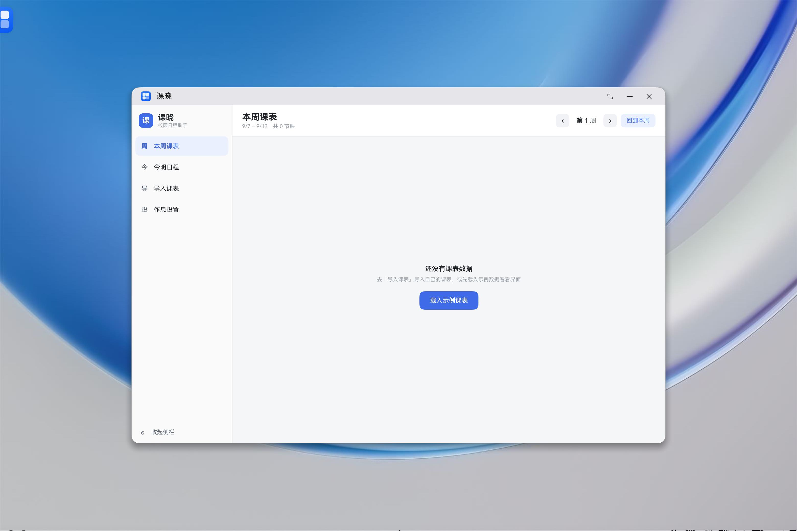
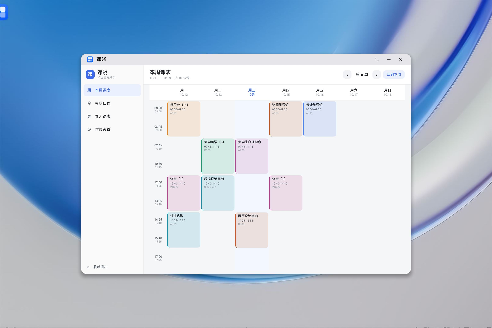
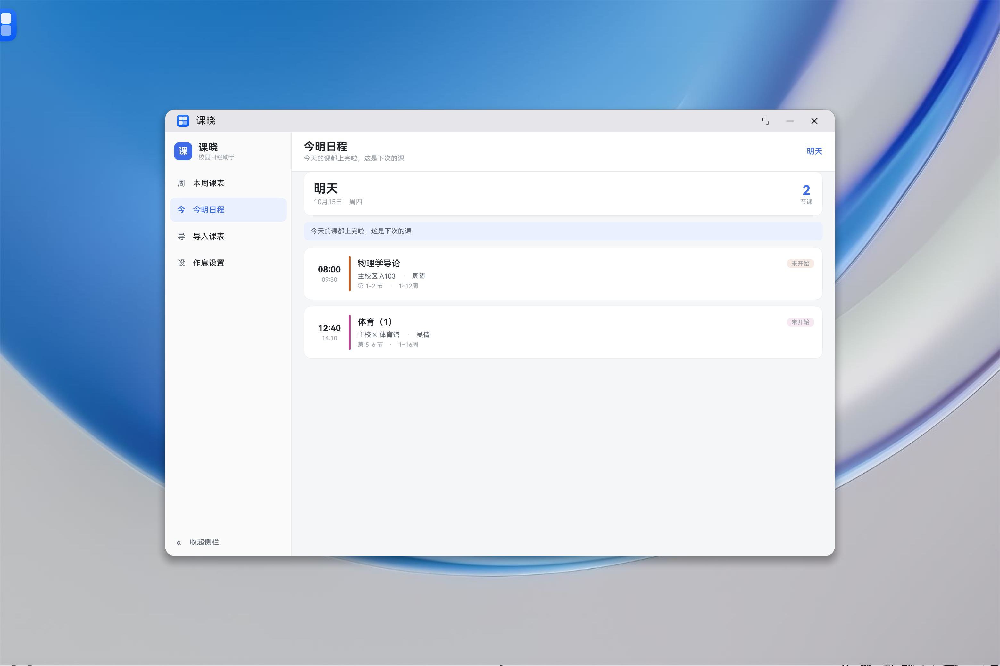
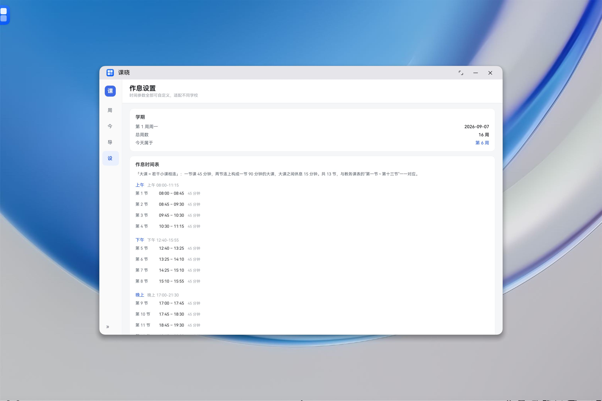
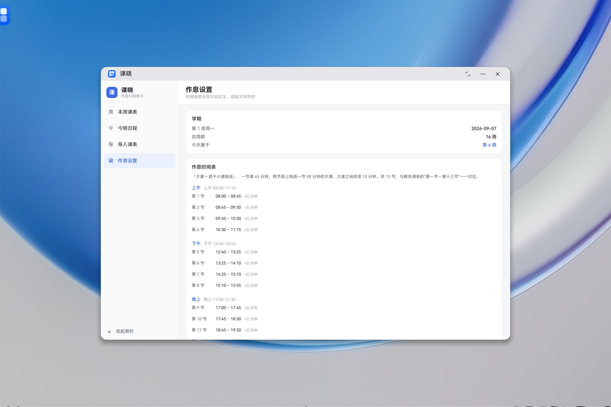

# 课晓 (kexiao)

> 面向 **HarmonyOS NEXT · 2in1（鸿蒙 PC）** 的轻量校园日程助手
> 把课程表、作业、待办整合到一起，做日程与闹钟提醒。

## 项目状态

🚧 **开发中** —— 已完成需求/架构设计、课表解析工具、时间模型与核心逻辑、主界面，
并已**在鸿蒙 PC 模拟器上实机跑通**。

| 模块 | 状态 |
|---|---|
| 需求与范围 | ✅ 草案 |
| 技术架构 | ✅ 草案 |
| 数据模型 | ✅ v0.2（含逐条排课的教室/教师） |
| 时间模型（可配置节次表） | ✅ **已完成**：13 节，大课=多小课嵌套 |
| docx 课表解析脚本 | ✅ 已跑通（示例课表 12 条全部正确） |
| 课表服务（周次过滤/日期换算/今明日程） | ✅ **已完成**，70 项断言全通过 |
| JSON 导入服务 | ✅ **已完成**（含去重、校验、告警） |
| 主界面（侧栏 + 周视图 + 今明日程 + 作息设置） | ✅ **已完成并实机验证** |
| 本地数据库（relationalStore） | ⬜ 待做 |
| 提醒 / 闹钟 | ⬜ 待做 |
| 桌面服务卡片 | ⬜ 待做 |
| 作业链接导入 | ⬜ 二期 |

## 工程信息

| 项 | 值 |
|---|---|
| 设备形态 | 2in1 / phone / wearable |
| 包名 (bundleName) | `com.sweethaohao.kexiao` |
| 应用显示名 | 课晓 |
| API 版本 | modelVersion 26.0.0，compatibleSdkVersion 6.1.1(24) |
| 语言 | ArkTS + ArkUI |

## 目录结构

```
DevEco/                          # 鸿蒙工程根目录
├── AppScope/                    # 应用级配置（bundleName、应用名）
├── entry/                       # 主 HAP 模块
│   └── src/main/
│       ├── ets/
│       │   ├── model/
│       │   │   ├── Models.ets        # 全部实体与视图模型
│       │   │   └── Defaults.ets      # 默认作息参数、课程配色
│       │   ├── common/
│       │   │   ├── DateUtil.ets      # 纯日期函数（周一为每周第一天）
│       │   │   └── SlotTimeTable.ets # 节次 ↔ 时间（大课=多小课）
│       │   ├── service/
│       │   │   ├── ScheduleService.ets  # 周次过滤 / 日期换算 / 今明日程 / 周视图
│       │   │   └── ImportService.ets    # JSON → 内部模型
│       │   ├── entryability/
│       │   └── pages/Index.ets       # 主界面
│       ├── resources/rawfile/                # 内置示例课表（sample-schedule.json，虚构数据）
│       └── module.json5
├── docs/                        # 📄 设计文档
│   ├── 01-需求与范围.md
│   ├── 02-技术架构.md
│   ├── 03-数据模型.md
│   ├── 04-课表导入方案.md
│   └── 05-时间模型与时次换算.md
├── tools/
│   ├── parse_schedule.py        # 教务 docx 课表 → JSON（Python 标准库，零依赖）
│   ├── selftest/                # 🧪 纯逻辑自测（Node 直跑，无需模拟器）
│   │   ├── run.mjs
│   │   └── cases.ts
│   └── dev/
│       ├── deploy.sh            # 一键编译+本地签名+安装到模拟器
│       ├── gen-signature.sh     # 换设备后重新生成签名材料（profile 绑定设备 UDID）
│       └── reset-app.sh         # 把设备复位成「全新安装」
├── docs/screenshots/            # 实机截图
├── LICENSE
└── README.md
```

## 快速开始

### 0. 首次准备：生成签名材料（克隆后必做一次）

`signature/` 里装着私钥、证书链与口令密文，**不入库**。克隆后先跑：

```bash
# 需要先在 DevEco 里启动模拟器、或连上真机（profile 要绑定设备 UDID）
bash tools/dev/gen-signature.sh
```

它会一次做好三件事：签发应用证书链与调试 profile、生成加密口令所需的密钥材料、
把口令密文回写进 `build-profile.json5`。不做这一步，hvigor 会因找不到签名材料而构建失败。

> 只想编译、不装到设备时，把 `build-profile.json5` 里的 `signingConfigs` 清空即可跳过。

### 1. 解析教务课表（电脑侧）

```bash
cd tools
# 输出放到工程外：真实课表不要提交进 Git，也不要放进 resources/rawfile/
python3 parse_schedule.py "我的课表.docx" -o ../../data/schedule.json
```

### 2. 跑逻辑自测（不需要模拟器）

```bash
# Node 22+ 自带 TypeScript 类型擦除，无需 npm install
node tools/selftest/run.mjs
```

`run.mjs` 会把 `entry/src/main/ets` 下的纯逻辑模块搬到 `.build/` 下当 `.ts` 跑，
所以**改完逻辑可以立刻验证**，不用等编译。

### 3. 装到模拟器 / 真机

在 DevEco Studio 里点「运行」最省事。如果想在命令行里一键走完
「编译 → 本地签名 → 安装 → 启动」，用：

```bash
bash tools/dev/deploy.sh          # 首次会自动生成签名材料
bash tools/dev/deploy.sh --shot   # 顺便截一张图
```

> 命令行编译出来的 HAP 是未签名的，`hdc install` 会失败。
> `deploy.sh` 用 SDK 自带的 OpenHarmony 调试证书在**纯本地**签发应用证书链与调试
> profile（绑定本机 bundleName 与设备 UDID），不依赖华为账号登录。

## 界面截图（鸿蒙 PC 模拟器实机）

| 首次打开（空态） | 周视图 |
|---|---|
|  |  |

| 今明日程（日常态） | 侧栏折叠 |
|---|---|
|  |  |

| 作息设置 | |
|---|---|
|  | |

> 截图里的数据是随包分发的**虚构示例课表**（第 6 周）。应用**首次打开是空态**，
> 点「载入示例课表」即可看到效果；模拟器时间为 17:00，周三的课都已上完，
> 所以「今明日程」按设计自动切到了最近有课的一天（周四）。
> 周视图里跨节次的课（如"微积分（上）"占第 1-2 节）是靠 `height = span × 单元高` 模拟合并单元格的。

## 数据与隐私

- 应用**不联网、不采集任何数据**，不上传课表，也不去访问教务系统。
- 课表由你自己在电脑上用 `tools/parse_schedule.py` 把教务导出的 Word 转成 JSON，再导入应用。
- ⚠️ **真实课表属于个人数据，绝不能进仓库、更不能进安装包**：
  - 解析产物请放在**工程外**，不要放进 `entry/src/main/resources/rawfile/`——那个目录会随 HAP 分发给所有用户；
  - 仓库里随包分发的是虚构样例 `sample-schedule.json`（课名、教师、教室均为编造）。

## 技术栈

- 平台：HarmonyOS NEXT，设备形态 **2in1 / phone / wearable**
- 语言/框架：ArkTS + ArkUI
- 存储：`relationalStore`（待接入）

## 设计原则

- **合规优先**：数据由用户主动提供（导入文件/手动/链接），不抓取、不读取第三方 App 数据。
- **一校一适配**：解析器、数据模型、作息参数三者解耦，换学校只改配置。
- **逻辑与界面分层**：纯逻辑不依赖 `@ohos` 能力，因此能在电脑上直接测试。

## 许可

（待定，作业用途）
